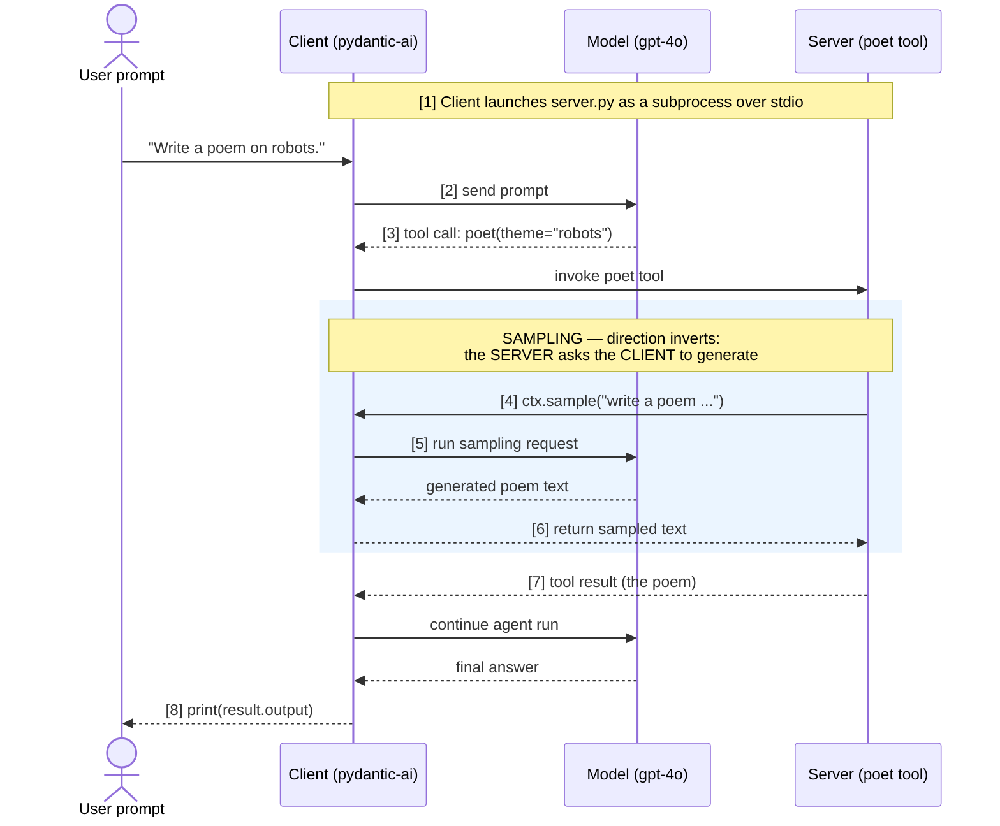

# MCP Sampling Example

This example demonstrates **MCP sampling** — where an MCP **server** asks the
**client** to run an LLM completion on its behalf.

The interesting part is that sampling **inverts the usual direction**: normally the
client calls tools on the server, but with sampling the *server* reaches back and
asks the *client's* model to generate text.

- [`client.py`](client.py) — starts the server as a subprocess (stdio), runs an agent
  on `gpt-4o`, and transparently **serves** the server's sampling requests with that
  same model.
- [`server.py`](server.py) — exposes a `poet` tool that, instead of generating a poem
  itself, calls `ctx.sample(...)` to ask the client to generate it.

## Workflow



### ASCII fallback

```
User prompt
   │  "Write a poem on robots."
   ▼
┌─────────────────────────┐        [1] launches as subprocess (stdio)
│  Client (pydantic-ai)   │ ─────────────────────────────────────────────┐
│  model: gpt-4o          │                                               │
└─────────────────────────┘                                               ▼
   │  [2] prompt                                             ┌──────────────────────┐
   ▼                                                         │  Server (poet tool)  │
 gpt-4o ──[3] tool call: poet("robots")──────────────────▶  │                      │
   ▲                                                         │  [4] ctx.sample(...) │
   │                                                         │   asks the client    │
   │   ◀───────────── [4] sampling request ──────────────── │   to generate        │
   │   [5] client runs the sampling request on gpt-4o        │                      │
   │   ───────────── [6] sampled poem text ───────────────▶  │                      │
   │                                                         │  [7] return result   │
   │  ◀──────────────── [7] tool result (poem) ───────────── └──────────────────────┘
   ▼
 gpt-4o → final answer
   │
   ▼
 [8] print(result.output)
```

## Key idea

| Normal MCP call            | Sampling                          |
| -------------------------- | --------------------------------- |
| Client → Server (run tool) | Server → Client (run completion)  |
| Client needs the tool      | Server needs the model            |

Because the client owns the model, the server can stay model-agnostic — it just says
"generate this for me" and the client decides *how* (which model, credentials, limits).

## Run it

From the repository root, with the virtual environment activated and your
`OPENAI_API_KEY` set (see the main [README](../README.md)):

```
cd sampling-example
uv run client.py
```

You'll see the control-flow logs printed in order (server logs go to **stderr**, since
stdout is the stdio protocol channel):

```
[SERVER] starting (stdio transport), waiting for the client...
[CLIENT] connected to server; sending prompt to the agent...
[SERVER] poet() tool called with theme='robots'
[SERVER] -> asking the CLIENT to generate a sample (ctx.sample)...
[SERVER] <- received sampled completion from the client
[CLIENT] agent run finished.

[CLIENT] final output:
...the poem...
```

> **Note:** this example uses the **stdio** transport, so it is unaffected by the SSE
> deprecation described in the main README. MCP sampling (`ctx.sample(...)`) is a
> current feature and is not deprecated.
